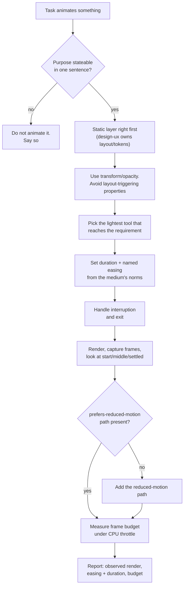

# Domain adapter: motion and animation

Applies when the deliverable moves: a UI transition, component micro-interaction, scroll-driven page sequence, hero timeline, kinetic type or data-viz animation, or a rendered video clip. The loop is unchanged; these definitions replace the coding defaults. Design decides what it looks like, this adapter decides whether it moves correctly. `design-ux` owns the static surface (tokens, layout, contrast); this adapter takes over once a property is animated, a timeline is sequenced, or a frame is rendered.

## Workflow (steps + flowchart)

1. **Decide whether it should animate at all, and why.** State the purpose (orientation, feedback, continuity, or delight) in one sentence. An animation with no answer is decoration, and decoration is what `prefers-reduced-motion` users must not pay for.
2. **Get the layer right.** Layout and static composition from `design-ux` first; motion is the last layer added, never a substitute for a layout that does not work standing still.
3. **Count the animated properties.** Transform and opacity are the compositor-cheap ones; animating `width`, `height`, `top`, `left`, `margin`, or `box-shadow` forces layout and is the default performance trap.
4. **Choose the tool by the frame budget.** CSS transitions/animations for one-shot UI state; a keyframe timeline for a sequence you can name; a host animation runtime (a scroll-triggered timeline library) only when scroll-driven sequencing, pinning, or layout transitions genuinely need it. Reach for the lightest that reaches the requirement.
5. **Set duration and easing from the medium's norms, then name them.** UI state changes live in the low-hundreds of milliseconds; a named easing beats `linear` for anything that starts or stops. Write the numbers into the code, not into the conversation.
6. **Handle interruption and exit.** A transition entered mid-flight and a component unmounted mid-animation are the two states that break naive implementations; both must be run before "done."
7. **Render it and look at it.** Run the animation, capture frames (a screenshot sequence or a recorded clip), and inspect the start, middle, and settled states. An animation not actually seen is unverified by definition.
8. **Run the motion checks.** Fidelity (easing is the one specified, duration is the one specified, no spring drift), a reduced-motion path, and a measured frame budget under a CPU throttle.

## Minimum evidence set (binding, before any render is called done)

1. **The motion spec**: the named duration and easing for each transition, and the trigger (hover, mount, scroll position, data change). If the project has a motion token set, it wins over invented values. If none exists, say so before inventing one.
2. **The reduced-motion policy**: whether the project honors `prefers-reduced-motion`, and the concrete alternative it renders when set. Absence is a finding, not a neutral default.
3. **The rendered output**: frames actually captured at the start, the middle, and the settled state, plus a frame-timing measurement on the real surface, not a sibling that merely resembles it.

## Evidence and primary sources

The rendered, captured output is the primary source; the animation code is a claim about it, and a screenshot of a single settled frame cannot confirm a curve. The sector's signature non-evidence: a screenshot taken after the animation finished (it proves only the end state, never the motion), and an easing named in chat but absent from the code.

## Authority order

Explicit user or client direction > the project's motion tokens or a named design system's motion spec > the referenced animation library's current documented behavior, fetched now > neighboring surfaces' existing motion in this codebase > your aesthetic preference. An explicit request to "make it pop" does not override a reduced-motion requirement; the accessibility floor wins and the conflict is surfaced.

## Verification by observation

- The animation was actually run and observed: frames captured at start, middle, and settled; a curve and a duration claimed but never rendered is unverified.
- Every animated value traces to a motion token or a named constant, not a scattered literal; find raw millisecond and Bezier literals sitting beside an existing motion token.
- `prefers-reduced-motion: reduce` was emulated and the surface re-rendered: motion removed or reduced, and the reduced state still communicates the same information as the animated one.
- A motion frame budget was measured on the real surface with CPU throttling: no animation of layout-triggering properties, and no long-frame cluster during the transition.
- Interruption and exit were exercised: the transition is started, interrupted mid-flight, and unmounted, with no stuck or orphaned state left behind.

## Fraud table (for mm-verify)

| Fraud | Symptom |
|---|---|
| Unrendered "done" | "the animation is finished" with no captured frames and no observed render |
| Screenshot-of-the-end | a still taken after the motion settled, presented as proof the motion is right |
| Asserted performance | "sixty fps" or "smooth" with no frame-timing measurement and no CPU throttle |
| Reduced-motion blindspot | a `prefers-reduced-motion` branch declared in prose but missing from the code, or present and never emulated |
| Layout-property animation | animating `width`, `height`, `top`, `left`, or `margin` where a transform would serve |
| Vanishing content | an element hidden by an animation that never runs under reduced motion, so the content is simply gone |
| Token betrayal | ad-hoc durations and Bezier literals beside an existing motion-token set |

## Done, by example

"The onboarding transition is done" means: purpose stated, transform/opacity only, duration and easing from tokens, rendered and watched at the start, middle and settled states, the reduced-motion alternative emulated and confirmed to still communicate the same thing, and the frame budget measured on the real surface with throttling. Not: "the animation code is written."

## Sources

- WCAG 2.2, Understanding Success Criterion 2.3.3 "Animation from Interactions" (motion triggers must be disableable unless essential) and 2.2.2 "Pause, Stop, Hide": https://www.w3.org/WAI/WCAG22/Understanding/animation-from-interactions.html (accessed 2026-10-14)
- MDN, `prefers-reduced-motion` (media query reference; the mechanism for honoring a reduced-motion preference): https://developer.mozilla.org/en-US/docs/Web/CSS/@media/prefers-reduced-motion (accessed 2026-10-14)
- MDN, "Animation performance and frame rate" (compositor-friendly properties, the render pipeline, and why transform/opacity are cheap): https://developer.mozilla.org/en-US/docs/Web/Performance/Guides/Animation_performance_and_frame_rate (accessed 2026-10-14)
- web.dev, "How to create high-performance CSS animations" (frame budget, `will-change`, and the properties that avoid layout and paint): https://web.dev/articles/animations-guide (accessed 2026-10-14)
- GreenSock, ScrollTrigger documentation (current behavior of the scroll-driven timeline runtime this adapter names as an option, fetched rather than recalled): https://gsap.com/docs/v3/Plugins/ScrollTrigger/ (accessed 2026-10-14)
- Emil Kowalski, `skills` (MIT): an authoritative open-source motion-craft reference for the timing, easing, and judgment steps above: https://github.com/emilkowalski/skills (accessed 2026-10-14)
- iart.ai, `web-animation-skills` (MIT): an authoritative open-source reference for the render-and-inspect verification loop and per-technique implementation guidance: https://github.com/iart-ai/web-animation-skills (accessed 2026-10-14)
- iart.ai, `motion-skills` pack index (MIT): the directory of per-audience motion packs (video, canvas, WebGL, kinetic type): https://github.com/iart-ai/motion-skills (accessed 2026-10-14)

## Coding gates in this domain

The grill gate applies. The prototype, test-first, and two-axis-review gates fire only for the animation's *code* (does the timeline logic do what it claims); the motion artifact itself is verified by render-and-observe, its stand-in for "run the tests" being captured frames plus a frame-timing measurement. The two-axis review's stand-in is a fidelity check (easing and duration match the spec) plus reduced-motion and frame-budget checks. The minimum evidence set above is binding regardless.
